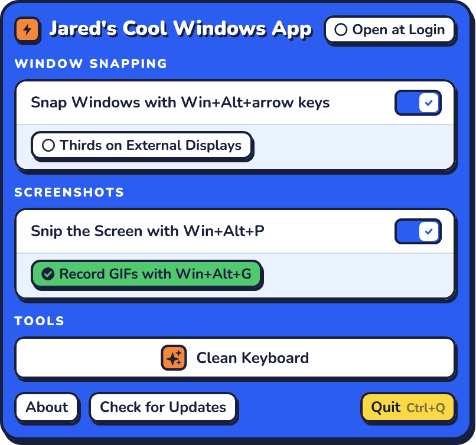
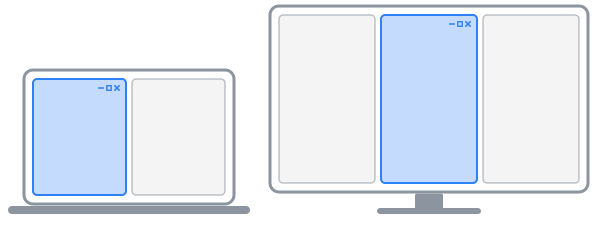
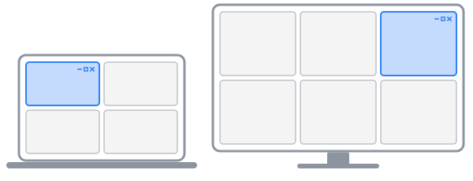

<h1 align="center">Jared's Cool Windows Utilities App</h1>

A Windows tray app with only the features I use. The Windows version of <a href="https://github.com/jfreema/Jareds-Cool-Mac-Utils-App">Jared's Cool Mac Utilities App</a>.

Windows 10 or 11 · 64-bit · <a href="https://github.com/jfreema/Jareds-Cool-Windows-Utils-App/releases/latest/download/JaredsWindowsUtils.exe">Portable version</a> · <a href="https://github.com/jfreema/Jareds-Cool-Windows-Utils-App/releases">All versions</a>

<table>
  <tr>
    <td width="50%"><b><a href="#window-snapping">Window snapping</a></b> Win+Alt and an arrow key put the window you're in into halves, thirds, quarters or sixths.</td>
    <td width="50%"><b><a href="#screenshot-tool">Screenshot tool</a></b> Win+Alt+P snips part of the screen to copy, save or mark up, or copies the text in it. Win+Alt+G records it as a GIF.</td>
  </tr>
  <tr>
    <td width="50%"><b><a href="#keyboard-cleaning">Keyboard cleaning</a></b> Turns off the keyboard and touchpad for a few minutes while you wipe them.</td>
    <td width="50%"><b><a href="docs/roadmap.md">Coming next</a></b> The Mac app's other features, one release at a time: staying awake with the lid closed is next.</td>
  </tr>
</table>

## Install

1. Open the **JaredsWindowsUtils-Setup.exe** you downloaded. If your browser warns that it isn't commonly downloaded, choose to keep it.
2. If Windows says **Windows protected your PC**, click **More info**, then **Run anyway**. The app isn't signed with a paid certificate, so Windows doesn't recognize it yet.
3. Click through the installer. It installs for you alone, so it doesn't ask for an administrator's password. The app opens and shows its menu.
4. Turn on **Open at Login** at the top of the menu.

The app's icon is in the taskbar's corner, by the clock: the J in shades. Click it for the menu. If Windows tucked it away under **^**, drag it from there onto the taskbar to keep it in view. Opening the app again from the Start menu also shows its menu.

To update, choose **Check for Updates** in the app's menu. It installs the newest version and restarts, keeping your settings.

**Without installing:** download the [portable version](https://github.com/jfreema/Jareds-Cool-Windows-Utils-App/releases/latest/download/JaredsWindowsUtils.exe), JaredsWindowsUtils.exe, and open it from any folder. Check for Updates replaces it where it is.

---

## Window snapping

Hold the Windows key and Alt and press an arrow key to put the window you're working in into halves, thirds, quarters or sixths of its display.

**Turn it on:** it's on from the start. Its switch is **Snap Windows with Win+Alt+arrow keys**, under **Window Snapping** in the menu.

**Use it:**

- **Win+Alt+Left and Win+Alt+Right** snap the window into the column it's mostly in, then move it a column at a time, across displays.
- **Win+Alt+Up** widens it to fill the display. From a third, it goes to two thirds first.
- **Win+Alt+Down** moves it clockwise through the display's quarters, or sixths.

Each display has two columns, or three on external displays with **Thirds on External Displays** on. A laptop's own screen keeps two, since it's too narrow for thirds.

| Win+Alt+Left and Win+Alt+Right | Win+Alt+Down |
|---|---|
|  |  |

Windows' own snapping, with the Windows key and the arrow keys or by dragging a window to an edge, keeps working too. Windows 11's Win+Alt+Up and Win+Alt+Down, for the top and bottom halves, give way to the app's while snapping is on.

**Why Win+Alt:** the Mac app uses control+option, but on Windows, Ctrl+Alt types accented letters on many keyboards, and VS Code, JetBrains IDEs and Magnifier use Ctrl+Alt+arrow keys. Apps leave the Windows key alone.

---

## Screenshot tool

Press Win+Alt+P to snip part of the screen, then copy it, save it, mark it up with boxes, lines, arrows, highlights, blurs and text, or copy the text in it. Press Win+Alt+G to record part of the screen as a GIF, like scrolling through a page, to paste into a message or a document.

**Turn it on:** it's on from the start. Its switch is **Snip the Screen with Win+Alt+P**, under **Screenshots** in the menu, and **Record GIFs with Win+Alt+G** under it turns GIFs on and off.

**Use it:** press Win+Alt+P and drag across part of the screen. Press Space to pick a whole window instead and click it, or press Esc to cancel. A menu opens where you let go, with **Copy to Clipboard**, **Copy Text**, **Open in Editor** and **Save…**. Click one, or use the arrow keys and Enter. Esc, or a click anywhere else, throws the snip away.

**Copy Text** copies the words in the snip as plain text, line by line, even where you can't select them, like an error message, a paused video or a scanned PDF. Windows reads them itself, on your PC, without sending the snip anywhere. If the app says Windows can't read text in your language, add **Optical character recognition** for it: in **Settings → Time & language → Language & region**, click **…** beside your language, then **Language options**.

In the editor, pick a tool on the left and drag across the snip to draw. Hold Shift to keep lines and arrows to 45° steps, and boxes, highlights and blurs square. Shapes sit on a soft shadow, so they stand out on any snip, and **Opacity** makes them see-through, down to 10%. **Blur** blurs the area you drag across, to hide a name or a password. For text, click where it goes, type, and press Enter. It goes on a rounded label in the color, and **Text Size** sets it from 10 to 24 points. With the **Eraser**, click a shape to take it away: the one under the pointer fades first.

To change a shape, click it. The one you just drew is picked up already, so you can change it straight away. Drag it to move it, drag its dots to resize it, pick another color, opacity, thickness or text size for it, or press Delete.

| Keys | What they do |
|---|---|
| R, L, A, H, B, T | Box, line, arrow, highlight, blur, text |
| E | Eraser |
| 1 to 6 | Red, green, blue, yellow, black, white |
| W | Thin or thick lines |
| Delete | Take away the shape you clicked |
| Ctrl+Z, Ctrl+Y | Undo, redo |
| Ctrl+C | Copy it with its shapes. The editor stays open. |
| Ctrl+S | Save it with its shapes. The editor closes. |
| Ctrl+W | Close the editor. If there are shapes you haven't copied or saved, it asks first. |

**Save…** saves a PNG, starting in Pictures\Screenshots, where Windows keeps its own screenshots, then wherever you saved last. Windows' own screenshots, with Windows key+Shift+S and Print Screen, keep working too.

**Record a GIF:** press Win+Alt+G, then drag across part of the screen, or click a window to record all of it. Click off any window for the whole screen, or press Esc to cancel. A red line goes around what's recording: scroll, click and type as you like, then click **Stop** under it or press Win+Alt+G again. It stops by itself after a minute. A menu opens where the pointer is, saying how long and how big the GIF is, with **Copy to Clipboard**, to paste it into Slack, Teams, an email or a document, and **Save…**. It's copied as a file, as File Explorer copies one, so it pastes as a GIF that moves.

GIFs show the pointer, but not the red line or **Stop**. They're 15 frames a second, sized as at 100% display scale, and 1280 pixels across at most. Parts that don't move cost next to nothing, so a smaller area or a shorter recording makes a smaller file. The wait before you start scrolling is cut to a second, and any pause along the way to two, so the GIF doesn't sit still each time it plays.

---

## Keyboard cleaning

Turns off the keyboard and touchpad for 5 minutes, so you can wipe them without typing or clicking anything.

**Turn it on:** it needs no permission, and it's always there. Choose **Clean Keyboard** under **Tools** in the app's menu.

**Use it:** choose **Clean Keyboard**, then click **Turn Off**. A window in the middle of the screen counts down until they come back on. To turn them back on sooner, hold down both Shift keys, left and right, for 1.5 seconds.

Every keyboard, touchpad and mouse is off, external ones too, but Ctrl+Alt+Delete still works. Caps Lock stays as it was. If the app ever stops answering, the keyboard and touchpad come back by themselves after a few seconds.

A touchscreen isn't turned off, and a touchpad's gestures, like three-finger swipes, may still get through on some laptops.

---

## Uninstall

Uninstall **Jared's Cool Windows Utilities App** in **Settings → Apps → Installed apps**. That quits the app and takes it out of Open at Login. Your settings stay in `%LocalAppData%\JaredsWindowsUtils`: delete that folder to remove them too.

For the portable version, turn off **Open at Login** if it's on, choose **Quit** in its menu, and delete JaredsWindowsUtils.exe.

Having problems? See [Troubleshooting](docs/troubleshooting.md).
